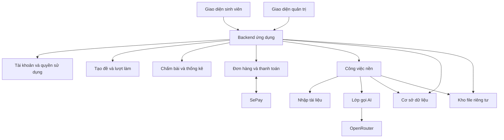

# Kiến trúc mục tiêu

Ngày cập nhật: 02/11/2026. Tài liệu mô tả kiến trúc mục tiêu. Mốc nền đã có Next.js 16.4.2, PostgreSQL local qua pg, migration, auth/session riêng, parser Frank và exam engine; xem PROGRESS và LOCAL_DEVELOPMENT cho bằng chứng/giới hạn. Các module AI, billing, job nền và quản trị dưới đây vẫn là mục tiêu chưa triển khai.

## Cấu trúc tổng thể

Một ứng dụng có các module tách rõ, dùng chung cơ sở dữ liệu. Tác vụ nhập tài liệu, sinh câu và chấm AI chạy qua cơ chế công việc nền có trạng thái, không phụ thuộc việc người dùng giữ trang mở. Triển khai nền có thể là bảng công việc và worker phù hợp nền tảng, chưa cần một hệ thống hàng đợi riêng.

## Các module và trách nhiệm

| Module | Sở hữu | Không tự làm |
| --- | --- | --- |
| Identity và Access | Tài khoản, phiên khách, role, entitlement và kiểm tra quyền | Không tin role hoặc trạng thái thanh toán từ client |
| Content | Nguồn, câu hỏi, phiên bản, hình, rubric, giải thích, phân loại | Không chấm lại lịch sử khi sửa câu |
| Import | Trích xuất, ghép đáp án, phát hiện lỗi, báo cáo nhập | Không sửa nguồn hoặc tự bịa phần thiếu |
| Exam Assembly | Bảng phân bổ, chọn câu, tránh trùng, snapshot đề | Không để LLM tự chọn tùy ý cả đề |
| Attempts | Đồng hồ, câu trả lời, lưu bài, nộp, khóa lượt | Không gửi đáp án trước hạn trong thi thử |
| Grading | Chấm trắc nghiệm bằng code, gọi AI cho tự luận/ảnh, tổng điểm | Không coi lỗi dịch vụ là đáp án sai |
| Learning Analytics | Kết quả theo chủ đề, số quan sát, đề xuất ôn tập đơn giản | Không kết luận yếu từ một quan sát hoặc tính điểm đang chờ là 0 |
| Billing | Đơn hàng, đối soát, webhook, quyền có hạn sử dụng | Không cấp quyền từ trang thông báo thành công của trình duyệt |
| AI Gateway | Model theo tác vụ, schema, giới hạn, timeout, usage, retry | Không có khóa API trong frontend |
| Administration | Quản trị nội dung, công việc, lỗi, người dùng, chi phí | Không thay đáp án âm thầm hoặc xóa bằng chứng |

## Phân môn và ngôn ngữ

Mỗi câu có metadata nội dung và quan hệ tới nguồn/chương. Câu kiến thức chung có thể dùng trong nhiều chương trình/môn nếu được phân loại phù hợp. Lưu độc lập môn của tài liệu, chủ đề kiến thức và nhóm người học; không gán “Vĩ mô” cho mọi câu chỉ vì tên file chứa Macroeconomics.

Mỗi yêu cầu AI chỉ nhận dữ liệu cần cho câu và môn/ngôn ngữ tương ứng. Không mang lịch sử môn khác hoặc prompt lớp 2 sang. Không cần AI điều phối lựa chọn môn đã rõ trong giao diện.

## Tạo đề có ràng buộc

Đầu vào gồm môn/ngôn ngữ, phạm vi chương, số câu, độ khó và tỷ lệ dạng bài. Đầu ra gồm snapshot đề, nguồn câu, phân bổ thực tế, tổng điểm và seed phục vụ tái hiện.

1. Xác thực quyền/hạn mức và tính khả thi từ kho đủ điều kiện.
2. Lập số câu/điểm cho các chương và dạng bài; quy tắc làm tròn phải nhất quán.
3. Chọn câu không trùng và giới hạn cùng họ câu; giữ đủ ngữ cảnh, hình và nhóm câu dùng chung dữ kiện.
4. Khi cấu hình cho phép, yêu cầu phần nhỏ câu mới qua pipeline kiểm định AI. Lưu câu mới theo trạng thái.
5. Kiểm tra tổng số câu/điểm, độ phủ, đáp án/rubric và media trước khi phát hành snapshot.

Không thay đổi ràng buộc âm thầm nếu thiếu câu. Trả thiếu hụt cụ thể và cấu hình thay thế. Tỷ lệ AI và hành vi khi AI không tạo được câu hợp lệ nằm ở O05; chỉ dùng fallback nằm trong chính sách đã cấu hình. Đề gốc giữ cấu trúc và thứ tự gốc; chế độ đề mới có thể xáo nhưng phải tôn trọng phụ thuộc.

## Lượt làm và chấm điểm

Trạng thái khái niệm: `in_progress → submitted hoặc expired → grading → completed`, có `grading_pending` khi tác vụ AI chưa xong. Không đánh đồng kết thúc thời gian làm bài với chấm xong.

- Backend lưu thời điểm bắt đầu/hạn chót, trạng thái và quyền sở hữu. Refresh không đặt lại giờ.
- Lưu tự động câu trả lời; retry cùng sự kiện không tạo bản nộp hay phí AI trùng.
- Chính sách nhận câu trả lời sau hạn dựa trên mốc server, không dựa đồng hồ client. Luồng hết giờ được kiểm thử rõ.
- Trong thi thử, đề trả về client không có đáp án, rubric bí mật hoặc lời giải. Sau nộp mới mở phần xem lại.
- Trong luyện tập, khóa lần gửi tương ứng, chấm và trả lời giải sau mỗi câu; tự luận/ảnh có thể hiện đang chấm.
- Tổng điểm có điểm tối đa đầy đủ và phần đang chờ. Không công bố điểm cuối nếu tiêu chí có trọng số chưa chấm xong.
- Sửa rubric/nguồn tạo phiên bản mới. Chấm lại là thao tác có lịch sử, không ghi đè điểm không dấu vết.

## Tác vụ nền

Mỗi job có loại tác vụ, đối tượng đích, trạng thái, số lần thử, thời gian, lỗi, khóa chống xử lý trùng và chi phí. Có thể tiếp tục sau lỗi ở phần chưa hoàn thành; không gửi lại cả tài liệu chỉ vì một câu lỗi. Worker giới hạn đồng thời theo ngân sách và nền tảng. Retry chỉ cho lỗi tạm thời, có trần; lỗi dữ liệu trả về báo cáo, lỗi khóa/số dư không được lặp sinh câu vô hạn.

## Thanh toán

Tách đơn hàng, giao dịch và quyền sử dụng. Xác thực webhook theo phương thức SePay đã cấu hình, kiểm tra tài khoản nhận tiền, chiều giao dịch, tiền tệ/số tiền và mã đơn. Giao dịch đã xử lý có khóa duy nhất; webhook lặp không cộng thời hạn lần hai. Đơn sai tiền hoặc không khớp vào hàng đối soát, không cấp quyền tự động. Gia hạn dựa trên một chính sách chu kỳ đã chốt ở O04.

## Lựa chọn triển khai

Ưu tiên mới ngày 02/11: dùng stack lõi tương tự Vui Học. Đề xuất Next.js App Router + React + TypeScript trên Node.js, CSS/Lucide và Zod; giữ UI độc lập theo taste-skill. OpenRouter đã chốt. Vui Học dùng PostgreSQL qua pg, cấu hình cloud Neon, Vercel Blob Private và Workflow SDK; đó là hiện trạng tham khảo, không tự động là nhà cung cấp của dự án mới.

Không dùng dịch vụ database cá nhân đang có hoặc thông tin kết nối của Vui Học. Công ty đã xác nhận dùng PostgreSQL; version, quyền tạo database/schema riêng và mạng kết nối sẽ kiểm tra khi chuyển. Dùng SQL/migration chuẩn, tách DATABASE_URL và tránh extension độc quyền; khi chuyển vẫn phải xuất/nhập dữ liệu, kiểm tra version/quyền/TLS và thử phục hồi. Development dùng một PostgreSQL riêng trên máy, không tự kết nối production công ty hoặc DB Vui Học.

Đã xác nhận tiếp ngày 02/11: công ty dùng PostgreSQL; người dùng muốn chạy trên máy trước và cho phép chọn cách thuận tiện. Đề xuất dùng PostgreSQL local riêng với driver pg; cách cài/chạy và version kiểm tra theo công cụ thực trên máy. Không cần kết nối công ty để bắt đầu. File development có thể lưu trong thư mục riêng được cấu hình và bảo vệ qua backend; kho production sẽ chọn sau. Giữ adapter/config riêng và migration để chuyển DB/file có kiểm tra, không hứa chỉ đổi biến môi trường là hoàn tất di chuyển.

Stack lõi theo hướng Next.js/React/TypeScript; auth, cơ chế job cụ thể và kho file production còn mở. Trước khi dựng ứng dụng lớn, kiểm chứng luồng local: đăng nhập, ghi DB, tải file riêng tư, tác vụ nền, gọi OpenRouter và khôi phục phiên làm bài. Webhook HTTPS và giới hạn nền tảng kiểm chứng trước tích hợp SePay/deploy thật.

Ưu tiên không phí hạ tầng trong thử nghiệm nhưng kiểm tra điều kiện dùng thương mại, giới hạn request/CPU, dung lượng file và tác vụ nền. Nhập nhiều DOCX/PDF có thể cần công cụ xử lý trên máy xây dựng trước khi đưa dữ liệu chuẩn vào dịch vụ. Đây là công cụ nhập liệu, không phải AI local. Nếu website admin nhập trực tiếp dùng đường xử lý khác, phải dùng chung hợp đồng nội dung và kiểm tra.

Không coi máy công ty 8 GB là đích bắt buộc. Không dùng filesystem tạm của serverless làm nơi lưu nguồn/bài làm bền vững. Cấu hình môi trường và migration phải tái lập được; tách test và production.

## Kiểm soát dữ liệu

File nguồn, bài làm và đáp án riêng tư; mọi lần lấy file kiểm tra quyền hoặc dùng URL ngắn hạn phù hợp. Nội dung trích từ tài liệu và bài làm không có quyền thay đổi chỉ dẫn hệ thống. Log kỹ thuật không chứa khóa bí mật hoặc toàn bộ bài làm không cần thiết. Admin sửa/quyết định/chấm lại đều có lịch sử. Có cơ chế sao lưu và kiểm tra phục hồi trước mở thử nghiệm.

## Cấu hình thử Vercel 02/11

Đã chuẩn bị Next.js trên Vercel với PostgreSQL bên ngoài; chưa có deploy cloud. Hình bank nhỏ có thể lưu bytea riêng tư trong DB theo T14, không phụ thuộc filesystem serverless hoặc thêm nhà cung cấp storage. Upload bài làm và job nền vẫn chưa triển khai. Xem VERCEL_DEPLOYMENT.md.
