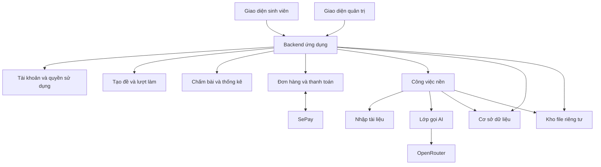

# Kiến trúc và luồng chính

Next.js/React/TypeScript, Node.js, PostgreSQL qua pg. Đã có tài khoản/phiên, parser Frank, exam engine và quản trị ngân hàng; AI, thanh toán và tác vụ nền bên dưới là thiết kế mục tiêu. Trạng thái thực ở PROGRESS.md, lệnh chạy ở README.

## Cấu trúc tổng thể

Một ứng dụng có các module tách rõ, dùng chung cơ sở dữ liệu. Tác vụ nhập tài liệu, sinh câu và chấm AI chạy qua cơ chế công việc nền có trạng thái, không phụ thuộc việc người dùng giữ trang mở. Triển khai nền có thể là bảng công việc và worker phù hợp nền tảng, chưa cần một hệ thống hàng đợi riêng.

## Các module và trách nhiệm

| Module | Sở hữu | Không tự làm |
| --- | --- | --- |
| Identity và Access | Tài khoản, phiên khách, role, entitlement và kiểm tra quyền | Không tin role hoặc trạng thái thanh toán từ client |
| Content | Nguồn, câu hỏi, phiên bản, hình, rubric, giải thích, phân loại | Không chấm lại lịch sử khi sửa câu |
| Import | Trích xuất, ghép đáp án, phát hiện lỗi, báo cáo nhập | Không sửa nguồn hoặc tự bịa phần thiếu |
| Exam Assembly | Bảng phân bổ, chọn câu, tránh trùng, snapshot đề | Không để LLM tự chọn tùy ý cả đề |
| Attempts | Đồng hồ, câu trả lời, lưu bài, nộp, khóa lượt | Không gửi đáp án trước hạn trong thi thử |
| Grading | Chấm trắc nghiệm bằng code, gọi AI cho tự luận/ảnh, tổng điểm | Không coi lỗi dịch vụ là đáp án sai |
| Learning Analytics | Kết quả theo chủ đề, số quan sát, đề xuất ôn tập đơn giản | Không kết luận yếu từ một quan sát hoặc tính điểm đang chờ là 0 |
| Billing | Đơn hàng, đối soát, webhook, quyền có hạn sử dụng | Không cấp quyền từ trang thông báo thành công của trình duyệt |
| AI Gateway | Model theo tác vụ, schema, giới hạn, timeout, usage, retry | Không có khóa API trong frontend |
| Administration | Quản trị nội dung, công việc, lỗi, người dùng, chi phí | Không thay đáp án âm thầm hoặc xóa bằng chứng |

## Phân môn và ngôn ngữ

Mỗi câu có metadata nội dung và quan hệ tới nguồn/chương. Câu kiến thức chung có thể dùng trong nhiều chương trình/môn nếu được phân loại phù hợp. Lưu độc lập môn của tài liệu, chủ đề kiến thức và nhóm người học; không gán “Vĩ mô” cho mọi câu chỉ vì tên file chứa Macroeconomics.

Mỗi yêu cầu AI chỉ nhận dữ liệu cần cho câu và môn/ngôn ngữ tương ứng. Không mang lịch sử môn khác hoặc prompt lớp 2 sang. Không cần AI điều phối lựa chọn môn đã rõ trong giao diện.

## Tạo đề có ràng buộc

Đầu vào gồm môn/ngôn ngữ, phạm vi chương, số câu, độ khó và tỷ lệ dạng bài. Đầu ra gồm snapshot đề, nguồn câu, phân bổ thực tế, tổng điểm và seed phục vụ tái hiện.

1. Xác thực quyền/hạn mức và tính khả thi từ kho đủ điều kiện.
2. Lập số câu/điểm cho các chương và dạng bài; quy tắc làm tròn phải nhất quán.
3. Chọn câu không trùng và giới hạn cùng họ câu; giữ đủ ngữ cảnh, hình và nhóm câu dùng chung dữ kiện.
4. Khi cấu hình cho phép, yêu cầu phần nhỏ câu mới qua pipeline kiểm định AI. Lưu câu mới theo trạng thái.
5. Kiểm tra tổng số câu/điểm, độ phủ, đáp án/rubric và media trước khi phát hành snapshot.

Không thay đổi ràng buộc âm thầm nếu thiếu câu. Trả thiếu hụt cụ thể và cấu hình thay thế. Tỷ lệ AI và hành vi khi AI không tạo được câu hợp lệ nằm ở O05; chỉ dùng fallback nằm trong chính sách đã cấu hình. Đề gốc giữ cấu trúc và thứ tự gốc; chế độ đề mới có thể xáo nhưng phải tôn trọng phụ thuộc.

## Lượt làm và chấm điểm

Trạng thái khái niệm: `in_progress → submitted hoặc expired → grading → completed`, có `grading_pending` khi tác vụ AI chưa xong. Không đánh đồng kết thúc thời gian làm bài với chấm xong.

- Backend lưu thời điểm bắt đầu/hạn chót, trạng thái và quyền sở hữu. Refresh không đặt lại giờ.
- Lưu tự động câu trả lời; retry cùng sự kiện không tạo bản nộp hay phí AI trùng.
- Chính sách nhận câu trả lời sau hạn dựa trên mốc server, không dựa đồng hồ client. Luồng hết giờ được kiểm thử rõ.
- Trong thi thử, đề trả về client không có đáp án, rubric bí mật hoặc lời giải. Sau nộp mới mở phần xem lại.
- Trong luyện tập, khóa lần gửi tương ứng, chấm và trả lời giải sau mỗi câu; tự luận/ảnh có thể hiện đang chấm.
- Tổng điểm có điểm tối đa đầy đủ và phần đang chờ. Không công bố điểm cuối nếu tiêu chí có trọng số chưa chấm xong.
- Sửa rubric/nguồn tạo phiên bản mới. Chấm lại là thao tác có lịch sử, không ghi đè điểm không dấu vết.

## Tác vụ nền

Mỗi job có loại tác vụ, đối tượng đích, trạng thái, số lần thử, thời gian, lỗi, khóa chống xử lý trùng và chi phí. Có thể tiếp tục sau lỗi ở phần chưa hoàn thành; không gửi lại cả tài liệu chỉ vì một câu lỗi. Worker giới hạn đồng thời theo ngân sách và nền tảng. Retry chỉ cho lỗi tạm thời, có trần; lỗi dữ liệu trả về báo cáo, lỗi khóa/số dư không được lặp sinh câu vô hạn.

## Thanh toán

Tách đơn hàng, giao dịch và quyền sử dụng. Xác thực webhook theo phương thức SePay đã cấu hình, kiểm tra tài khoản nhận tiền, chiều giao dịch, tiền tệ/số tiền và mã đơn. Giao dịch đã xử lý có khóa duy nhất; webhook lặp không cộng thời hạn lần hai. Đơn sai tiền hoặc không khớp vào hàng đối soát, không cấp quyền tự động. Gia hạn dựa trên một chính sách chu kỳ đã chốt ở O04.

## Trải nghiệm sử dụng

- Catalog lọc bốn nhóm môn/ngôn ngữ; nhóm thiếu nguồn hiện chưa có nội dung. Chính sách năm đề khách/gói chưa được chốt chi tiết thì không giả có quyền.
- Luyện tập phản hồi đúng câu sau gửi; thi thử chỉ mở đáp án sau kết thúc. Lỗi mạng giữ lựa chọn chưa lưu và hiển thị trạng thái thật; xác nhận nộp nêu số câu bỏ trống.
- Kết quả/tiến trình phân biệt điểm đã có, pending, lần đầu và làm lại; nhận định chủ đề kèm số quan sát. Phân biệt lần đầu/làm lại còn phải triển khai.
- Upload bài vẽ mục tiêu: gắn từng ý, xem trước/xoay/thay/xóa trước nộp, giữ thứ tự trang PDF; lỗi mờ/thiếu trang báo cụ thể. Định hướng JPG/PNG/WebP/PDF, giới hạn theo O07. Chấm nhận file ảnh thật, không chỉ mô tả văn bản.
- Màn thi ưu tiên câu/công thức/hình/ô trả lời/trạng thái lưu; bảng/hình rộng xử lý trong vùng riêng. Kiểm tra 1440/768/390, bàn phím, focus và trạng thái trống/tải/lỗi theo taste-skill. Không tự dùng logo NEU hoặc thông điệp bảo chứng.

## Database và triển khai

Mọi thao tác DB dùng DATABASE_URL trong .env.local, kể cả phát triển và kiểm thử tích hợp; không chạy DB local riêng hoặc tự đổi đích. Không dùng dữ liệu/tài khoản DB Vui Học. Giữ URL/khóa ngoài log và commit. Migration SQL có checksum, khóa transaction; không sửa migration đã áp.

Hình bank hiện lưu bytea trong PostgreSQL (MEDIA_STORAGE=postgres), chỉ phục vụ sau kiểm quyền. Không coi đây là kho upload bài làm. Chưa chọn kho production cho bài làm hoặc hoàn tất job nền. Không dùng filesystem tạm serverless để lưu dữ liệu bền vững.

Chưa deploy public. Hosting phải phù hợp sử dụng thương mại, HTTPS, network/TLS DB, giới hạn pool/CPU/job và ngân sách. Sao lưu và kiểm chứng phục hồi trước mở thử nghiệm; không coi việc DB từ xa chạy được là đã có deploy/backup đầy đủ. Các script smoke cũ bị khóa vào local không được dùng; smoke:workspace đã dùng DB cấu hình với fixture riêng và dọn đúng ID test.

## Kiểm soát dữ liệu

File nguồn, bài làm và đáp án riêng tư; mọi lần lấy file kiểm tra quyền hoặc dùng URL ngắn hạn phù hợp. Nội dung trích từ tài liệu và bài làm không có quyền thay đổi chỉ dẫn hệ thống. Log kỹ thuật không chứa khóa bí mật hoặc toàn bộ bài làm không cần thiết. Admin sửa/quyết định/chấm lại đều có lịch sử. Có cơ chế sao lưu và kiểm tra phục hồi trước mở thử nghiệm.

## Khu quản trị

Tách điều hướng và kiểm quyền admin khỏi learner ở cả client và API. Admin chỉ xem trước đề quản trị, không tạo attempt; managed_exams giữ snapshot/version/trạng thái và được kiểm tra lại version/status câu khi phát hành và khi người học bắt đầu. source_uploads là hàng đợi nhập có file gốc private trong DB; parser Python đồng bộ có timeout, claim/retry quá hạn, bulk transaction và chống trùng hash. Đổi role/khóa có audit và thu hồi phiên; khóa theo account, không phải chặn danh tính khách qua mọi thiết bị. content_reports nhận đúng câu/attempt của chủ bài. admin_audit giữ lý do và đối tượng thao tác. ai_usage mới là nơi ghi nhận usage, gateway ghi usage thật còn chưa kết nối. Không giả có đơn hàng/quyền gói khi SePay chưa triển khai.
